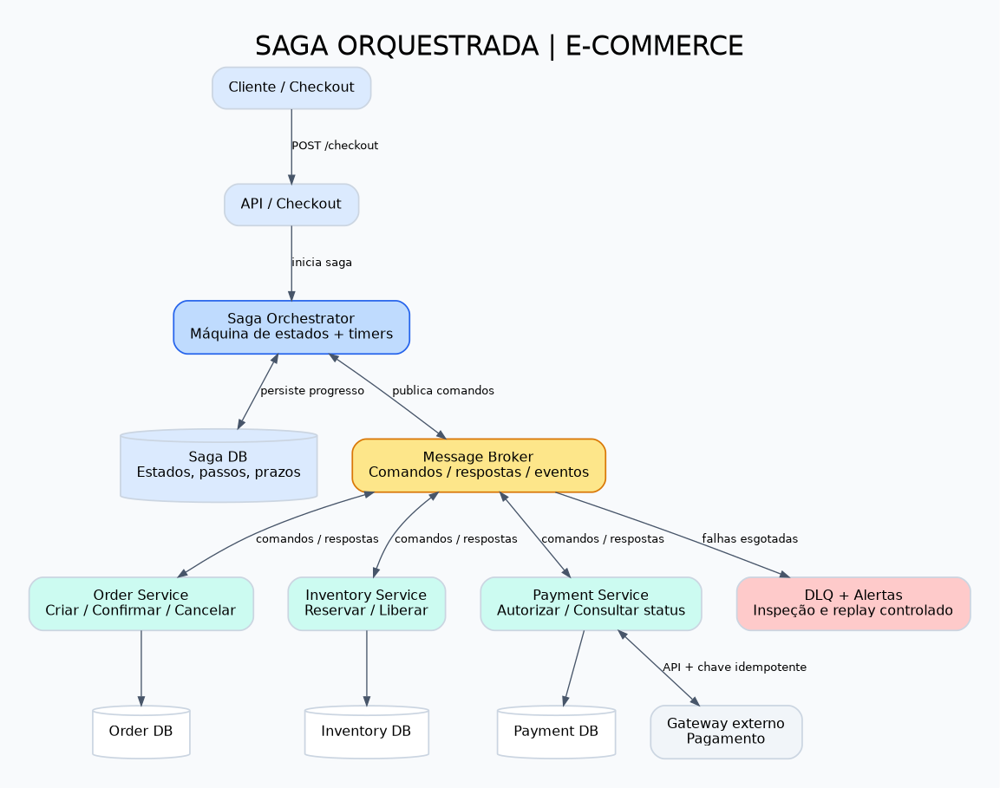
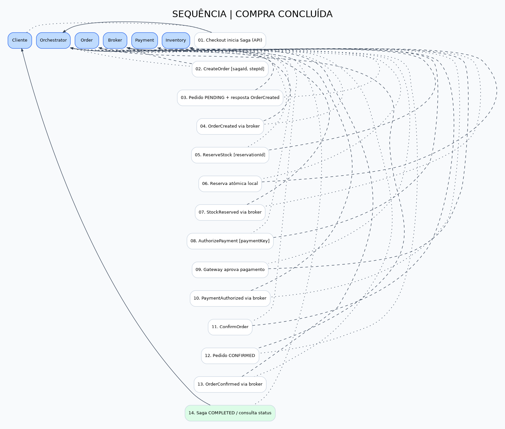
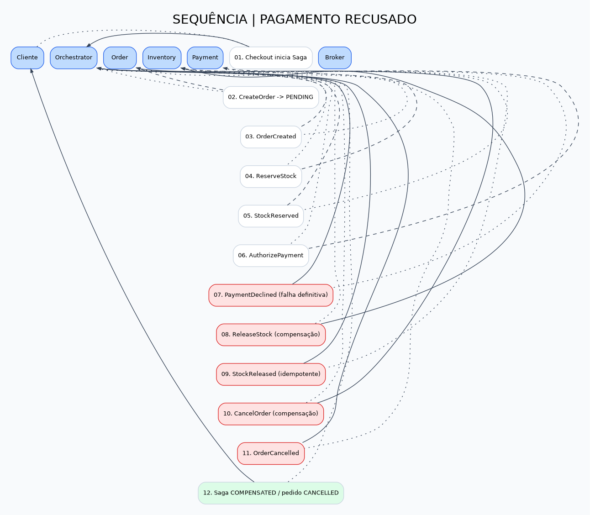

# Blueprint de Arquitetura — Saga Orquestrada no E-commerce

Projeto acadêmico de arquitetura de microsserviços, sem implementação de aplicação. Demonstra consistência eventual, compensações, idempotência e resiliência em uma compra distribuída.

## 1. Contexto e objetivo

A migração de um monólito de e-commerce para microsserviços cria três bancos de dados independentes: **Order Service**, **Inventory Service** e **Payment Service**. Não há uma transação ACID global. O objetivo é garantir que uma falha no pagamento após a reserva de estoque provoque a liberação da reserva e o cancelamento do pedido.

> **Nota de arquitetura:** Saga não fornece atomicidade global nem rollback de banco de dados entre serviços. As compensações são novas operações de negócio, potencialmente sujeitas a falhas, e a consistência é eventual.

## 2. Decisão: Orquestração

Adota-se **Saga por Orquestração**: um orquestrador persistente coordena comandos e respostas assíncronos via broker, controla estados e aplica compensações. A alternativa de **Coreografia** distribuiria decisões entre consumidores de eventos.

| Critério | Orquestração (escolhida) | Coreografia |
|---|---|---|
| Acoplamento | Dependência explícita dos contratos de comando; reduz dependências de fluxo entre serviços | Menor acoplamento ao coordenador; dependências implícitas entre eventos |
| Complexidade | Centraliza transições e tratamento de falhas | Fluxo e depuração distribuídos entre consumidores |
| Escalabilidade | Orquestrador deve escalar horizontalmente e persistir estado | Consumidores escalam de forma independente |
| Observabilidade | Visão única do progresso da Saga | Requer correlação distribuída mais cuidadosa |

O orquestrador **não compartilha bancos de domínio**. Cada serviço mantém autonomia e realiza transações ACID somente no seu próprio banco.

## 3. Diagramas

### Visão geral


O cliente inicia o checkout. O orquestrador persiste o estado da Saga e usa um barramento de mensagens para comandos e respostas. Cada serviço possui sua própria base de dados. O Payment Service conversa com o gateway externo. A DLQ recebe mensagens que esgotaram tentativas automáticas.

### Sequência de sucesso


1. Criar pedido `PENDING`.
2. Reservar estoque de forma idempotente.
3. Autorizar pagamento no gateway usando chave idempotente.
4. Confirmar pedido `CONFIRMED`.
5. Registrar Saga `COMPLETED`.

### Sequência de falha e compensação


1. Pedido criado e estoque reservado.
2. Pagamento recusado definitivamente.
3. Saga entra em `COMPENSATING`.
4. Envia `ReleaseStock` e aguarda confirmação `StockReleased`.
5. Envia `CancelOrder` e aguarda `OrderCancelled`.
6. Marca Saga `COMPENSATED` e pedido `CANCELLED`.

**Atenção:** timeout de pagamento não significa recusa. Nesse caso o orquestrador consulta o status do pagamento antes de decidir por compensação. Se houver captura efetiva de fundos, é necessária compensação financeira `RefundPayment` antes de concluir a reversão.

## 4. Contratos de comunicação

Os comandos e respostas usam mensageria assíncrona (at-least-once). O `POST /checkout` inicial e o `GET /orders/{orderId}` são síncronos. Um envelope mínimo de mensagem:

```json
{
  "messageId": "uuid",
  "sagaId": "uuid",
  "orderId": "uuid",
  "stepId": "reserve-stock-v1",
  "type": "ReserveStock",
  "correlationId": "uuid",
  "occurredAt": "2026-10-14T20:00:00Z",
  "payload": {"reservationId": "uuid", "items": [{"sku": "SKU-1", "quantity": 1}]}
}
```

Principais pares comando/resposta: `CreateOrder`/`OrderCreated`, `ReserveStock`/`StockReserved`, `AuthorizePayment`/`PaymentAuthorized` ou `PaymentDeclined`, `ConfirmOrder`/`OrderConfirmed`, `ReleaseStock`/`StockReleased`, `CancelOrder`/`OrderCancelled`.

## 5. Estados e garantias

Estados da Saga: `STARTED`, `ORDER_CREATED`, `STOCK_RESERVED`, `PAYMENT_AUTHORIZED`, `CONFIRMING`, `COMPLETED`, `COMPENSATING`, `COMPENSATED`, `MANUAL_REVIEW`.

- **Idempotent Consumer:** índice único por `consumerName + messageId` no inbox; registrar processamento e alteração de domínio na mesma transação local. Comandos usam também chaves de negócio estáveis (`orderId`, `reservationId`, `paymentKey`).
- **Transactional Outbox:** mudança de estado e publicação pendente são gravadas na mesma transação local; um publicador entrega o evento ao broker e pode reenviá-lo sem comprometer a idempotência.
- **Timeout:** estado persistente e prazo `deadlineAt`; worker de recuperação reavalia sagas vencidas, consulta resultado desconhecido e reenvia comando com a mesma chave.
- **Falha definitiva:** compensar na ordem inversa dos passos já concluídos.

## 6. Documentação técnica e arquivos editáveis

- [Decisões arquiteturais, riscos e matriz de idempotência](docs/decisoes-arquiteturais.md)
- Diagramas em `diagrams/*.png`, versões vetoriais em `diagrams/*.svg` e **fontes editáveis em Graphviz DOT** (`diagrams/*.dot`). Os arquivos `.dot` podem ser editados e renderizados novamente usando `dot -Tpng arquivo.dot -o arquivo.png`.

## 7. Como apresentar

Mostre a arquitetura geral, depois o fluxo de sucesso, depois a falha de pagamento e as compensações. Explique por que a recusa definitiva é diferente de um timeout e finalize com inbox/outbox, DLQ, retries e observabilidade.

## 8. Limites

Este repositório é uma **especificação de arquitetura**, não um sistema executável nem uma integração real com gateway de pagamentos.
